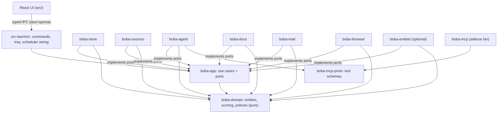
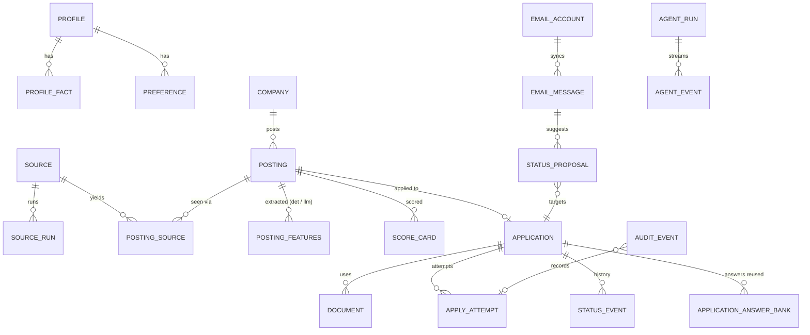

# Architecture Spine — Boba Job Find

## Design Paradigm

**Hexagonal modular monolith.** One Rust process (the Tauri core) holds all business logic. `boba-domain` is pure: entities, scoring, and policies, with no IO. `boba-app` holds the use cases and the **port** traits. Each IO concern is an **adapter** crate that implements a port. The React UI is a thin client: it renders, collects input and calls typed commands. The LLM is an external worker. It runs inside the agent CLI the user picked, and it reaches the app only through the Boba MCP tool surface.



Arrows mean "may depend on". Nothing depends on `src-tauri/src`. Adapters never depend on each other: cross-adapter work goes through a use case in `boba-app`. `boba-domain` depends only on `serde`, `thiserror`, `time` and `ulid`. **Every type that crosses a port lives in `boba-domain`**: port traits in `boba-app::ports` take and return domain types only, so an adapter's own types never leak upward and `boba-app` never needs an adapter crate.

## Invariants & Rules

### AD-1 — Shell and process model [ADOPTED]
- **Binds:** all
- **Prevents:** a second runtime (Node or Python server) holding business logic beside Rust.
- **Rule:** Tauri v2. One long-lived core process. The only first-party sidecar is `boba-mcp`. Every other child process is third-party (agent CLIs, the user's Chrome, user-trusted custom adapters) and is spawned and supervised only by the core's `ProcessSupervisor`. Each child gets its own process group or Windows Job Object, so cancelling kills the whole tree.

### AD-2 — Single data owner
- **Binds:** storage, every module
- **Prevents:** two writers to one DB, and plaintext copies of user data scattered across processes.
- **Rule:** only `boba-store`, inside the core process, opens the SQLCipher database. The UI, `boba-mcp`, agent CLIs and adapters read and write data only through core use cases (IPC commands or MCP tools). There is one writer connection (a DB actor) plus a read pool. No component writes user data to disk outside the DB, except an explicit user **Export** to a path the user picked, and the per-run agent workspace (AD-6). Agent workspaces are deleted when the run ends.

### AD-3 — Typed IPC contract
- **Binds:** UI ↔ core
- **Prevents:** stringly-typed `invoke` drift and UI types that disagree with Rust types.
- **Rule:** every command and event is declared in Rust and exported to `src/lib/ipc/bindings.ts` by tauri-specta. Never edit the generated file by hand, and never call `invoke` directly in the UI. **Registration has one source:** `src-tauri/src/ipc/command_list.rs` (`.gitattributes` `merge=union`). It defines `boba_commands!` (`tauri_specta::collect_commands![…]`) and `boba_events!` (`collect_events![…]`), one fully qualified fn or type path per line, each ending in a comma. A slice that adds a command appends one line there and never edits `ipc/mod.rs`, which is the only `tauri_specta::Builder` site and only calls the two macros. A bad union merge (a duplicate line, a missing comma) fails compilation, and the bindings-up-to-date check in CI catches drift. There is no second runtime registry. Commands return `Result<T, AppError>`. Events are past-tense facts named `<area>.<thing>.<verb-ed>`, for example `posting.scored`, `agent.run.progressed`. The UI uses commands to write and events to invalidate TanStack Query caches. It keeps no mirror of server state in Zustand.

### AD-4 — Agent runtime: CLI adapters behind one port
- **Binds:** every LLM-using capability
- **Prevents:** per-feature CLI invocation code, and features that only work on one CLI.
- **Rule:** features call `AgentPort::run(AgentTask) -> RunHandle`, which streams normalized `AgentEvent`s (`Started | Text | ToolCall | ToolResult | Usage | Finished | Failed`). Each supported CLI is one `CliDriver` that implements detect, version, list models, build the command and parse the event stream. Capabilities (`stream_json`, `mcp`, `tool_lockdown`, `budget_flag`, `turn_flag`, `structured_output`) are **probed at detection**, not hardcoded. A task declares the capabilities it needs and its `input_trust` (`untrusted | user`). A CLI that lacks a required capability is **unsupported** for that task (hard gate, no override), and the UI says why (ADR-010).

### AD-5 — The LLM proposes, the core disposes
- **Binds:** scoring, documents, apply, email, profile
- **Prevents:** a hallucinated number ranking an offer, and an injected prompt sending an application.
- **Rule:** agent output is stored only as **proposals or drafts**, each with provenance `{agent_run_id, cli, model}`. The agent never writes a score, a status change or a submission. Scores come only from `boba-domain::scoring`. Applications are submitted and emails are sent only by the Apply engine, after a policy check (AD-11). There is no MCP tool for submitting, sending, deleting or changing settings.

### AD-6 — Agent tool surface = Boba MCP only
- **Binds:** agent runtime, security
- **Prevents:** posting or email text making the agent run shell commands, fetch URLs or read files.
- **Rule:** every run executes in a fresh workspace dir under app data. The MCP config lists only `boba-mcp`, with strict-MCP mode where the CLI supports it. Native shell, file-write and web tools are disabled through the CLI's allowlist or sandbox flags. A CLI that cannot disable them gets `security: degraded`, and the UI must show that before the user picks it. `boba-mcp` connects to the core over a local socket or named pipe, readable by the owning user only. It authenticates with a per-run token passed in an env var. The core exposes only the tool subset declared by that run's task, and enforces a per-run limit on tool calls and wall-clock time. **A task with `input_trust = untrusted` runs only on a CLI with verified `tool_lockdown`**: no native web or fetch tool, no shell with network, and no writes outside the workspace. A degraded badge is not a substitute, and there is no user override (ADR-010). At startup the core deletes leftover run workspaces before the scheduler starts.

### AD-7 — Untrusted-content boundary
- **Binds:** sources, email, agent, UI
- **Prevents:** prompt injection and XSS from third-party text.
- **Rule:** text from postings, email bodies and company pages is `Untrusted`. Over MCP it is always returned inside a `{"untrusted_content": …}` envelope, and the agent-pack system prompt states that this content is never an instruction. In the UI it is sanitized HTML (ammonia) or plain text, and it is never rendered with `dangerouslySetInnerHTML` unsanitized. Links inside untrusted text are never fetched automatically. **Agent output is untrusted too.** Text written by a run that read untrusted input is stored with `untrusted_origin = true`, rendered only as plain or sanitized text, passed to Typst only as JSON data (never as markup), and re-wrapped in the envelope when a later run reads it (ADR-010).

### AD-8 — Deterministic, offline, versioned scoring
- **Binds:** scoring, ranking UI, notifications, auto-apply
- **Prevents:** scores that change between runs for the same inputs, and ranking that depends on network or LLM availability.
- **Rule:** implements `docs/research/offer-scoring.md`: Gates → Fit (F1–F6) → Quality (Q1–Q5) → `rank = w_fit·Fit + w_quality·Quality`. It is pure (`fn score(&PostingFeatures, &ProfileSnapshot, &Prefs, &MarketData) -> ScoreCard`). Every factor emits `{score, weight, matched[], missing[], evidence[], confidence}`. If a factor is missing (no embeddings, no salary data, no LLM features), its weight is renormalized across the others and the confidence is lowered. It is never imputed. A `ScoreCard` is stored immutably, keyed by `(posting_id, profile_version, prefs_version, scoring_model_version)`. When any of these changes, the core rescores. LLM narration is stored separately and never changes the card.

### AD-9 — Source Adapter SDK and access classes
- **Binds:** sources, connections UI, apply
- **Prevents:** adapters with their own HTTP stacks, opt-in logic or legal labels.
- **Rule:** every source implements `SourceAdapter { manifest(), search(&Query, &Ctx), detail(&ExternalId, &Ctx) }` and returns `RawPosting` only. The manifest declares:
  - `access_class` (`official_api | public_json | rss | html_scrape | session_browser | external_process`)
  - `legal_tier` (`safe | caution | prohibited_automation`)
  - rate limits
  - attribution text
  - `apply_capability` (`none | link_out | ats_form | sanctioned_api | email | session_form`)
  - required secrets

  The registry refuses to run `html_scrape`, `session_browser` or `external_process` sources until the user records an **opt-in** for that exact source. The opt-in stores a timestamp and the warning version shown.

### AD-10 — One outbound network policy
- **Binds:** sources, enrichment, browser, email
- **Prevents:** adapters that hammer hosts or evade anti-bot measures.
- **Rule:** all HTTP goes through the core's shared `HttpClient`. It applies a per-host token bucket (governor), honours each manifest's limits, checks robots.txt before fetching HTML, and sends an honest User-Agent: `BobaJobFind/<ver> (+repo URL)`. The code never solves CAPTCHAs, spoofs fingerprints, rotates proxies or uses fake accounts. When a CAPTCHA or login wall appears, the step downgrades to **assist** mode, where the user acts.

### AD-11 — Apply policy engine
- **Binds:** apply, scheduler, tray, settings
- **Prevents:** auto-apply firing outside what the user configured, or after the kill switch was pulled.
- **Rule:** each `(source)` has `apply_mode ∈ {off, assist, auto}`. `auto` is selectable by default only when `apply_capability ∈ {ats_form, sanctioned_api, email}`. Sources with `session_form` (LinkedIn Easy Apply, Indeed and similar, `legal_tier = prohibited_automation`) can be set to `auto` **only** after all of these: the source's opt-in (AD-9) with an account-ban/ToS warning, a 30-day re-confirmation, and the strict cap, pacing, Outbox hold and auto-pause-on-challenge defaults from PRD FR-91 (the product owns those numbers; the engine enforces them as settings). An application auto-sends only if **all** of these hold:
  - score ≥ the source threshold, and confidence ≥ the minimum
  - no gate returned FLAG or VETO
  - the documents passed verification (AD-14)
  - the daily caps (global and per-source) are not exhausted
  - the kill switch is off

  The engine re-checks the kill switch **immediately before every irreversible step**. Everything else lands in the "Ready to review" queue (assist).

  **Enforcement lives in the core only.** `boba_domain::apply::decide` is the single policy function. The core calls it when an attempt is created, when the Outbox releases it, and right before submit. The UI never decides: it only displays the `Decision` and its reasons. Policy settings are validated in core commands, which reject out-of-range values, including the hard ceiling of 10/day for `session_form` sources. A `session_form` opt-in is accepted only through a core command that receives the typed confirmation phrase and the warning version, and records both in the audit log. Outbox holds, pacing, and the auto-pause after a CAPTCHA or challenge are scheduler-owned core state, so closing or reloading the UI cannot bypass them.

### AD-12 — Append-only, hash-chained audit log
- **Binds:** apply, email, browser automation, settings changes affecting automation
- **Prevents:** silent or unexplainable outbound actions.
- **Rule:** each outbound action writes an `audit_event` row **before** it runs (`intent`) and **after** it runs (`outcome`). Each row stores `prev_hash` and `hash = blake3(prev_hash ‖ canonical_json(row))`, where `canonical_json` is RFC 8785 (JCS) over every column except `hash`. SQL triggers reject UPDATE and DELETE on `audit_event`. Rows hold **metadata, IDs and blake3 hashes of payloads** (Package, email body), never the payloads themselves, so retention sweeps on documents and email stay authoritative while the chain stays intact. On startup, an `intent` with no `outcome` (crash) gets an `outcome = unknown_after_crash` row, and the attempt goes to Needs attention. The latest hash is mirrored to the keychain (`audit-head`) on every append and checked at startup. An anchor that names an earlier known row (a crash) is re-synced; an anchor that names no row is shown to the user as tampering. **The canonical form is frozen (v1)**: its exact key order, escaping and the `prev_hash`-prefix layout are in ADR-011. Changing it requires a versioned chain, never re-hashing. ADR-011 also records the accepted residual risks. The UI can show and export the log. Users can wipe it only through Reset everything.

### AD-13 — Encryption at rest and secrets
- **Binds:** storage, connections, email, sources
- **Prevents:** plaintext PII or tokens on disk.
- **Rule:**
  - **Database:** SQLCipher, via rusqlite `bundled-sqlcipher-vendored-openssl`. The key is a random 256-bit value stored in the OS keychain (keyring-core + platform store; service `app.bobajobfind`). Generated documents and attachments are stored as BLOBs inside the DB. If no keychain is available (headless Linux without Secret Service), the user sets a passphrase and the key is derived with Argon2id. That key is never persisted.
  - **Never mint a key over existing data.** A new key is generated only when no `boba.db` exists. If the DB exists and the key can't be read, the app enters the **Locked state**: an unlock screen, scheduled jobs recorded as `skipped_locked` with a notification, never a silent success (ADR-009).
  - **macOS signing identity.** Keychain access is bound to the binary's designated requirement, so **every** macOS build is signed with one persistent self-signed certificate (pinned designated requirement; Apple Developer ID later), and updates keep reading `db-key`. Local dev builds use a separate keychain service and data dir (ADR-009).
  - **Passphrase path:** unlock once per login session; key in `zeroize`d memory with an idle timeout (default 8 h).
  - **Forced recovery backup:** on builds without Apple Developer ID or Authenticode, onboarding can't finish until a passphrase-protected recovery backup exists.
  - **Secrets:** OAuth refresh tokens, API keys and adapter credentials go to the keychain only. The DB stores an opaque `secret_ref`. In memory they are held in `secrecy`/`zeroize` types and are never logged.

### AD-14 — One document model, verified renders
- **Binds:** documents, apply
- **Prevents:** PDF and DOCX diverging in content, and unverified documents being sent.
- **Rule:** tailoring produces a structured `CvDocument` or `CoverLetterDocument` (JSON, schema-versioned). The model types (`CvDocument`, `CoverLetterDocument`, `TemplateId`, the layout report) live in `boba_domain::documents`. `boba_app::ports::RenderPort` takes them, and `boba-docs` implements it. Renderers are pure functions of `(document, template, locale)`: Typst (embedded crate) produces the PDF and docx-rs produces the DOCX. A document is `verified` only if all of these pass:
  - the page budget (CV ≤ 2 pages, letter = 1 page), measured on the laid-out Typst document
  - the ATS text layer (extract the PDF text, check that the contact details are literal and every required keyword the profile backs is present, and that no `(cid:` or U+FFFD characters appear)
  - the fabrication check (AD-15)

  Only `verified` documents may be attached to a submission.

### AD-15 — Fabrication guardrail
- **Binds:** profile, documents, agent pack
- **Prevents:** claims in a CV that the user never made.
- **Rule:** the profile is a set of `profile_fact` rows (stable ULIDs). Facts are **immutable**: editing a fact creates a new row that `supersedes` the old one and bumps `profile_version`, so documents always cite the exact text they used. Every claim-bearing item in a tailored document carries `fact_ids[]`. The validator rejects any item with no facts or with unknown facts. Missing keywords go in `declared_gaps[]`. They are never added to the text.

### AD-16 — Entity ownership
- **Binds:** all modules
- **Prevents:** two modules owning one table.
- **Rule:** each table has exactly one owning module, and only that module's use cases write it. The ownership map is in *Structural Seed → Data*. Other modules read through the owner's query functions. Application status changes go **only** through apply's `TransitionStatus` use case. It validates against the `boba-domain` status state machine and writes a `status_event`. User actions, approved email proposals and apply outcomes all call it.

### AD-17 — IDs, time, money, language
- **Binds:** all data and IPC
- **Prevents:** mismatched identifiers and units.
- **Rule:**
  - **IDs:** ULID strings, prefixed by type in IPC (`pst_…`, `app_…`).
  - **Timestamps:** UTC RFC 3339 text, converted to local time in the UI only.
  - **Money:** `{amount_minor: i64, currency: ISO-4217, period: year|month|hour}`.
  - **Languages:** BCP-47 (`en`, `es`, `es-MX`).
  - **Two separate language settings:** *UI locale* (user setting, OS default) and *content language* (detected per posting with lingua, and it drives the document language).

### AD-18 — One scheduler, idempotent jobs
- **Binds:** scheduler, tray, ingestion, email
- **Prevents:** duplicate daily runs and lost runs after sleep.
- **Rule:** the single-instance plugin is enabled. One in-core scheduler owns all recurring jobs (`daily_search`, `email_sync`, `rescore`, `retention_sweep`). Each execution is a `job_run` row with a unique `(job, scheduled_for)`. On launch or wake, missed slots inside the catch-up window run once. Jobs must be idempotent. Ingestion dedup (AD-19) makes reruns safe.

### AD-19 — Canonical posting and dedup key
- **Binds:** ingestion, sources, scoring, tracker
- **Prevents:** the same job showing up twice from two sources.
- **Rule:** `RawPosting` is normalized into one `posting` plus N `posting_source` provenance rows. The dedup key is a port of upstream's `job_key.py`: the normalized slug of `company + title + location-bucket`, with a hash disambiguator, plus the canonical apply URL. A simhash of the description catches near-duplicates across sources at ≥ 0.9 similarity. Dedup only merges. It never deletes provenance.

### AD-20 — Migrations
- **Binds:** storage
- **Prevents:** schema drift between installs.
- **Rule:** forward-only SQL files in `src-tauri/crates/boba-store/migrations/NNNN_name.sql`, embedded at compile time and run by rusqlite_migration. The core takes an automatic encrypted snapshot (`VACUUM INTO`) before migrating: `<appdata>/snapshots/`, owner-only, same key, only if free disk ≥ 2× DB size, deleted after 3 successful launches or 14 days (whichever is later) and by Reset (ADR-009). Restores are opened read-only, validated (`boba_backup_meta`, `PRAGMA integrity_check`, schema not newer than the app), then migrated forward. Never edit a shipped migration.

### AD-21 — Shared i18n catalogs
- **Binds:** UI, tray, notifications, agent pack
- **Prevents:** strings that exist in only one language, and core-side strings stranded outside the catalogs.
- **Rule:** `locales/{en,es}/<namespace>.json` (ICU message format) is the single source of user-facing strings. The UI loads it through i18next. The core embeds it with `include_str!` for the tray and notifications. CI fails on a key that is missing in either language. Core-emitted error keys stay namespace-less but live one file per area, `locales/{en,es}/errors/<area>.json` holding `errors.<area>.*` (CH7), so two slices never edit the same catalog; both loaders merge them into the default namespace, and CI rejects an error key left in a plain catalog file. Agent-pack prompts live in English and take a `target_language` parameter.

### AD-22 — Signed, tag-driven releases
- **Binds:** packaging, updater, CI
- **Prevents:** unsigned updates, and version/tag drift that causes update loops.
- **Rule:** a `v*` tag triggers the release workflow (tauri-action v1, macOS/Windows/Linux matrix). Updater artifacts are **always** signed with the Tauri minisign key, and the pubkey ships in `tauri.conf.json`. OS code signing follows the free OSS path (§17 Q1): Windows is unsigned until SignPath Foundation accepts the project. macOS uses the stable self-signed identity until Apple Developer ID arrives, and CI fails on any ad-hoc macOS build (AD-13). `tauri.conf.json` `version` must equal the tag without the `v`, and CI enforces this. Releases are published, not left as drafts, so `latest.json` resolves. CI never publishes on a push to `main`.

## Consistency Conventions

| Concern | Convention |
| --- | --- |
| Rust naming | Crates `boba-<area>`. Ports are `trait <Thing>Port: Send + Sync` in `boba-app::ports` (every port and repo trait has the `Send + Sync` supertrait so it can sit in Tauri state as `Arc<dyn …>`). Adapters are `<Impl><Thing>` (`SqlcipherPostingRepo`, `ClaudeCodeDriver`, `GreenhouseAdapter`). |
| TS naming | Feature folders `src/features/<area>/`. Components PascalCase. Hooks `use<Thing>`. Query keys `[area, ...params]`. |
| Errors | Core: `thiserror` enums per crate, mapped to `AppError {code, message_key, details}`. `message_key` is an i18n key. The UI never shows raw error strings. |
| Logging | `tracing` with structured fields. PII and untrusted text are never logged (only IDs and lengths). Rolling local files through tauri-plugin-log. No telemetry and no remote crash reporting. |
| Config | User settings live in the DB `setting` table (typed keys), never in loose JSON files. App-level defaults are compiled in. |
| Long work | Anything that can take more than 300 ms runs as a core task that emits `*.progressed` and `*.finished` events and can be cancelled through `CancellationToken`. |
| MCP tools | `snake_case` verbs (`get_pending_postings`, `propose_posting_features`, `save_document_draft`). Inputs and outputs are JSON-Schema'd in `boba-mcp-proto`. Write tools are named `propose_*` or `save_*_draft`. |
| Agent pack | `agent-pack/skills/<task>/SKILL.md` (Agent Skills format) + `agent-pack/system.md`. One skill per `AgentTask`. Rendered per CLI into the run workspace (`CLAUDE.md` / `AGENTS.md` / `GEMINI.md`). |
| Wiring | One composition root (ADR-012): `lib.rs` calls `wiring::mount` once; ports are registered as one `app.manage::<Arc<dyn Port>>(…);` line each in `src-tauri/src/wiring/port_list.rs` (`merge=union`). Commands obtain ports only via `wiring::port::<dyn P>(&app)`, which returns `ErrorCode::Locked` when the store is not open. |
| Tests | Domain: pure unit tests and golden ScoreCards. Adapters: recorded HTTP fixtures, with no live network in CI. UI: Vitest + Testing Library. E2E: WebdriverIO + tauri-driver on Linux/Windows. |

## Stack

| Name | Version |
| --- | --- |
| Tauri (crate / CLI / JS API) | 2.12.x |
| Rust (edition 2024; toolchain pinned via rust-toolchain.toml) | 1.99 (MSRV 1.92, set by typst) |
| React / React DOM | 19.3 |
| TypeScript | 7.0 |
| Vite | 8.3 |
| Tailwind CSS | 4.3 |
| shadcn (CLI, Radix primitives) | 4.21 / radix-ui 1.6 |
| TanStack Query | 5.104 |
| React Router | 8.4 |
| Zustand | 5.0 |
| react-hook-form / zod | 7.89 / 4.6 |
| i18next / react-i18next | 26.4 / 17.0 |
| tauri-specta / specta / specta-typescript | =2.0.0-rc.25 / =2.0.0-rc.25 / =0.0.12 |
| rusqlite (bundled-sqlcipher-vendored-openssl) | 0.40 |
| rusqlite_migration | 2.6 |
| keyring-core + platform stores | 1.0 |
| tokio | 1.53 |
| reqwest | 0.13 |
| typst / typst-pdf | 0.15 |
| docx-rs | 0.4.22 |
| chromiumoxide | 0.9 |
| rmcp (MCP SDK) | 3.5 |
| fastembed (multilingual-e5-small, optional) | 7.1 |
| tauri-action (GitHub) | v1 |

The full list, with licences and rejected alternatives, is in `tech-stack.md`.

## Structural Seed

```text
boba-job-find/
  src/                          # React UI (thin client)
    app/                        # shell, router, providers, theme
    features/<area>/            # onboarding, matches, offer, tailoring, tracker, connections, settings
    components/ui/              # shadcn components (owned copies)
    lib/ipc/bindings.ts         # GENERATED by tauri-specta — do not edit
    styles/tokens.css           # DESIGN.md token bridge (:root/.dark/@theme)
  locales/{en,es}/*.json        # shared i18n catalogs (UI + core)
  locales/{en,es}/errors/*.json # core error keys, one file per area (CH7)
  agent-pack/                   # portable "boba" agent: system.md + skills/<task>/SKILL.md
  templates/{cv,cover}/*.typ    # Typst templates + fonts/ (OFL)
  src-tauri/
    src/                        # tauri app: commands, events, tray, scheduler wiring, setup
      ipc/command_list.rs       # merge=union: the ONLY command/event registration list (AD-3)
    crates/
      boba-domain/              # entities, scoring, gates, apply policy (pure)
      boba-app/                 # use cases + port traits
      boba-store/               # SQLCipher repos + migrations/
      boba-sources/             # SourceAdapter impls + registry + HttpClient
      boba-agent/               # CliDrivers, ProcessSupervisor glue, agent-pack renderer, MCP server (core side)
      boba-mcp-proto/           # tool schemas shared by core + shim
      boba-mcp/                 # stdio↔local-IPC shim binary (Tauri externalBin)
      boba-docs/                # Typst/DOCX renderers + verification
      boba-mail/                # Graph / Gmail-send / IMAP-SMTP adapters + classifier rules
      boba-browser/             # CDP automation (chromiumoxide)
      boba-embed/               # optional F3 embeddings: EmbeddingPort impl over fastembed (cargo feature `embeddings`)
  .github/workflows/{ci,release}.yml
  docs/
```

Data (owners per AD-16; names and relationships only):



| Owner module | Tables |
| --- | --- |
| profile | profile, profile_fact, preference |
| sources | source, source_run, source_optin |
| ingestion | posting, posting_source, company, posting_features |
| scoring | score_card, score_narration, market_benchmark |
| documents | document (templates are compiled-in files identified by `template` id; no table) |
| apply | application, apply_attempt, status_event, outbox, application_answer_bank |
| email | email_account, email_message, status_proposal |
| agent | agent_run, agent_event, cli_install |
| core/system | setting, job_run, audit_event, secret_ref |

## Capability → Architecture Map

| Capability / Area | Lives in | Governed by |
| --- | --- | --- |
| Onboarding: CLI detect + model pick | boba-agent `CliDriver::detect`, features/onboarding | AD-4, AD-6 |
| Profile / master-CV import | boba-app profile use cases + `profile_import` agent task | AD-5, AD-15 |
| Job-board connections, custom sources | boba-sources registry, features/connections | AD-9, AD-10, AD-13 |
| Daily search (tray, notifications) | src-tauri scheduler + tray, boba-app ingest use case | AD-18, AD-19, AD-21 |
| Ranking (Fit/Quality, gates, explanation) | boba-domain scoring, `narrate_scores` task | AD-8, AD-5 |
| CV and cover-letter tailoring (PDF/DOCX, ES/EN) | boba-docs, `tailor_application` + `review_application` tasks | AD-14, AD-15, AD-17 |
| Apply (assist / auto, caps, kill switch) | boba-app apply engine, boba-browser, boba-mail | AD-11, AD-12, AD-10 |
| Tracker pipeline | boba-app apply/status, features/tracker | AD-16, AD-12 |
| Email reply → status | boba-mail, `classify_emails` task | AD-5, AD-7, AD-13 |
| Export, backup, reset | boba-store | AD-2, AD-13, AD-20 |
| i18n EN/ES | locales/, i18next, core catalog | AD-21, AD-17 |
| Packaging, update, CI | .github/workflows, tauri.conf.json | AD-22 |

## Deferred

- **LaTeX / user-toolchain templates** (upstream `/add-template`). Typst covers MVP. Revisit when users ask for their own LaTeX.
- **`external_process` adapters** (upstream Bun CLI contract). The access class and opt-in are reserved now. The runner ships in v1.1.
- **Gmail restricted-scope read.** Deferred on the bundled project client (Diego, 2026-10-04): it requests `gmail.send` only. MVP reads Gmail through a BYO Google client (story 8.5), IMAP, or `.eml` import. CASA later.
- **Interview prep, upskill, expand.** These are agent tasks on the same AgentPort, with no architectural impact. Their schemas are decided when they are scheduled.
- **Score-weight calibration from outcomes.** It needs N outcomes. It will be a domain function that proposes new `prefs` versions, and AD-8 already makes rescoring safe.
- **Multi-profile, sync between devices, mobile.** Out of scope (local-only, single user).
- **Mac App Store / Microsoft Store distribution.** Sandboxing conflicts with spawning third-party CLIs. Direct download only.
