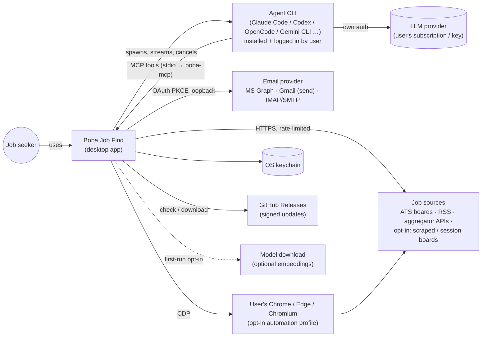
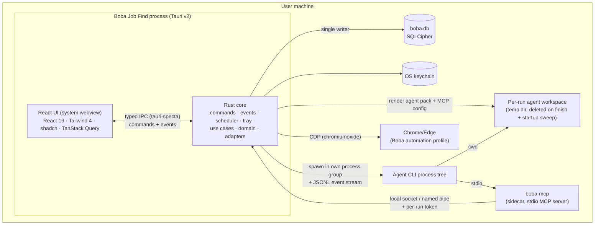
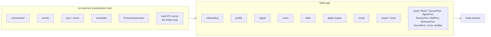
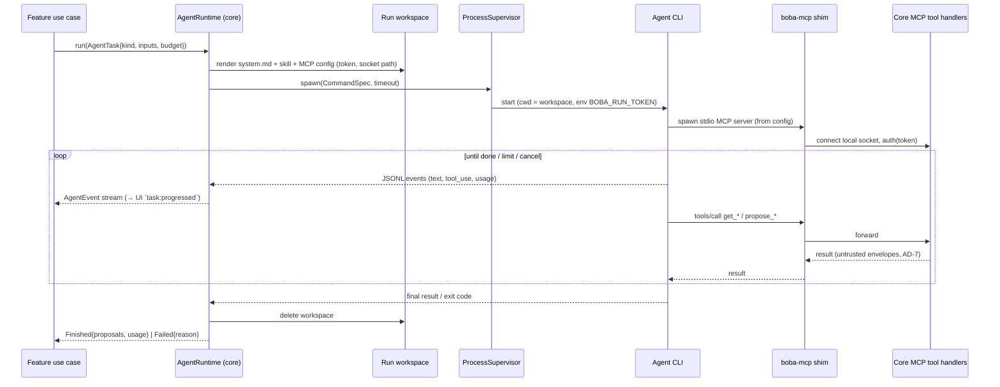
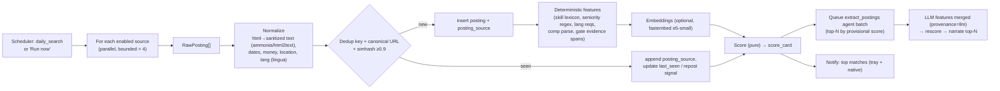
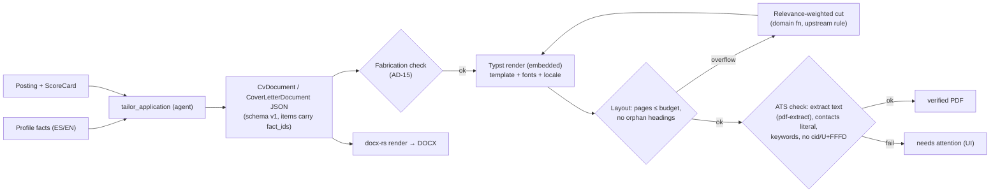
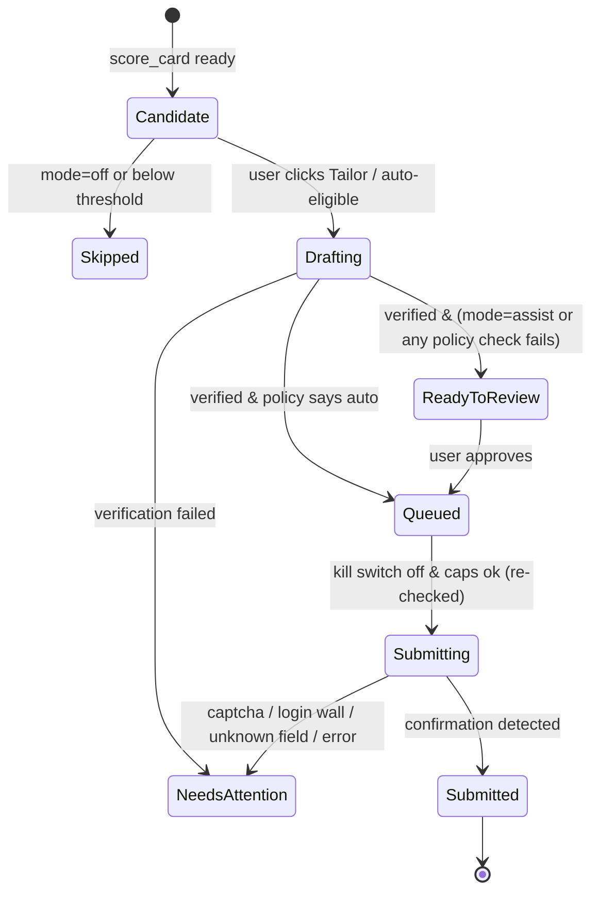

# Boba Job Find — Architecture

> **Status:** v1.1, 2026-10-04 (§17 closed; planning-audit fixes in §17.1) · **Owner:** architect (Winston) · **Audience:** PM (stories), dev, reviewer, UX
> **Binding contract:** [`ARCHITECTURE-SPINE.md`](./ARCHITECTURE-SPINE.md). Decision IDs `AD-n` cited here are defined there.
> **Companions:** [`tech-stack.md`](./tech-stack.md) · [`adr/`](./adr/) · inputs: [`../research/`](../research/), [`../design/DESIGN.md`](../design/DESIGN.md), `AGENTS.md`.

Boba Job Find is a local-first desktop app. It finds job offers, ranks them on **Fit** and **Quality**, tailors a CV and cover letter for each application, and applies, either with the user reviewing first (*assist*) or automatically (*auto*) within limits the user sets. All LLM work goes through an **agent CLI the user already has installed** (Claude Code, Codex, OpenCode, Gemini CLI…). The app ships the specialized "boba" agent: prompts, skills and MCP tools. Nothing leaves the machine except calls to job sources, the user's email provider and the LLM provider behind the user's own CLI.

---

## 1. Architectural drivers

| Driver | Consequence |
|---|---|
| Local-only, encrypted, no accounts | No backend at all. One encrypted SQLite file plus the OS keychain. Updates come from GitHub Releases. |
| User-chosen agent CLI is the LLM engine | We never hold model API keys. An **Agent Runtime** layer normalizes many CLIs behind one port. Every capability the agent needs comes through our MCP server. |
| Auto-apply exists, but sources' ToS differ | A **policy engine** with access classes, per-source opt-ins, caps, a kill switch and a hash-chained audit log. |
| Ranking must be trustworthy | **Deterministic, offline** scoring (offer-scoring.md). The LLM only extracts features and narrates. It never sets numbers. |
| Non-technical users | No Python, Bun, LaTeX or Node required. A single installer per OS, with PDF rendering and verification embedded in Rust. |
| Team skill set: TS/React, Rust, Python | Tauri v2 (Rust) and React. Python is not needed at runtime (ADR-007). |

---

## 2. System context



The app never talks to an LLM API directly, and it never sees the user's LLM credentials. The CLI owns them.

---

## 3. Containers



| Container | Tech | Responsibility | Must not |
|---|---|---|---|
| React UI | TS, React, Vite | Render, collect input, call commands, subscribe to events | Hold business rules, call `invoke` by hand, render unsanitized HTML |
| Rust core | Tauri 2, tokio | All logic, all IO, all persistence, process supervision | Embed LLM API clients |
| boba-mcp | Rust bin (externalBin) | Translate the MCP stdio protocol to core IPC. Stateless. | Open the DB or read secrets |
| Agent CLI | Third-party | LLM reasoning for one `AgentTask` | Get shell, web or file tools (AD-6) |
| SQLCipher DB | `boba.db` in app data dir | All user data, including document blobs | Be opened by any other process |
| Chrome profile | User's browser | Opt-in session automation and ATS form fill | Be launched against the user's personal profile |

---

## 4. Rust core — module boundaries

Hexagonal layering (AD-1, spine diagram): `domain` ← `app` (use cases and ports) ← adapters. `src-tauri/src` is the composition root.



### 4.1 Composition root (`src-tauri/src`)

- **Commands.** One Rust module per feature area. Each command is a thin wrapper (validate, call a use case, map the error). All commands are registered through `tauri_specta::Builder`, which exports `src/lib/ipc/bindings.ts` in debug builds. CI checks that the file is up to date (AD-3).
- **Events.** Typed `specta` events, `<area>:<verb-ed>`, with no dots (Tauri 2.12 rejects them; ADR-017). The registered events are `task:progressed`, `task:finished`, `run_report:progressed`, `kill_switch:changed` and `notification:opened`. A validity test in `ipc/mod.rs` runs every registered name through Tauri's own validation.
- **Tray.** Tauri `tray-icon` feature. The menu shows: Open · Run search now · *Today: N new matches* · **Pause all automation (kill switch)** · Quit. Closing the window hides it to the tray. The autostart plugin is opt-in, offered during onboarding.
- **Scheduler (AD-18).** A tokio task that wakes every minute and evaluates cron expressions (`cron` crate) against `job_run`. It catches up on missed slots after sleep or launch. Jobs: `daily_search` (default 08:00 local), `email_sync` (every 30 min if connected), `rescore` (on profile/prefs version bump), `retention_sweep` (weekly). While the app is **Locked** (ADR-009), each due job is recorded as `skipped_locked` and one notification is sent per slot. A job is never marked as succeeded.
- **ProcessSupervisor.** Spawns children with `process-wrap`: a process group on Unix and a Job Object on Windows, with kill-on-drop. It enforces the wall-clock timeout, captures stdout and stderr line by line, and turns cancellation into kill-tree. Children: agent CLIs, the user's Chrome for CDP, and (v1.1) external-process adapters.
- **Local IPC server.** An `interprocess` local socket (Unix domain socket under app data, mode 0600; a Windows named pipe with an owner-only DACL). It serves MCP tool calls proxied by `boba-mcp`, after authenticating the per-run token.
- **Window.** `tauri.conf.json` sets `minWidth: 960, minHeight: 640` (DESIGN.md floor). Design tokens come from DESIGN.md §14 into `src/styles/tokens.css`. Fonts are bundled woff2 via @fontsource.
- **Plugins used:** single-instance, notification, autostart, updater, process, dialog, opener, window-state, log, global-shortcut (kill switch). No deep-link plugin: OAuth is loopback-only (§11). The **shell plugin is not exposed to the UI.** Tauri capabilities grant the webview only `core:default`, our own commands and the dialog/opener/notification/updater permissions.

### 4.2 `boba-domain` (pure)

Entities, value objects (`Money`, `LangTag`, `Ulid` newtypes), **scoring** (§8), **gates**, **apply policy evaluation** (`fn decide(attempt_ctx) -> Decision`), dedup key, status state machine. It has no IO, no async and no tokio, so it can be tested with golden files.

### 4.3 `boba-app` (use cases and ports)

Use cases orchestrate ports. Examples: `RunDailySearch`, `ScorePosting`, `StartTailoring`, `ApproveAndSend`, `SyncEmail`, `ImportProfileFromCv`, `ExportAll`. Ports are traits. Adapters are injected at the composition root, so tests use in-memory fakes.

### 4.4 Adapters

| Crate | Implements | Notes |
|---|---|---|
| `boba-store` | `Repo*`, `SecretPort` (the DB side), migrations | §12 |
| `boba-sources` | `SourcePort`, `HttpClient` | §6 |
| `boba-agent` | `AgentPort`, core-side MCP tool handlers, agent-pack renderer | §5 |
| `boba-docs` | `RenderPort`, `VerifyPort` | §9 |
| `boba-mail` | `MailPort` | §11 |
| `boba-browser` | `BrowserPort` | §6.4, §10 |

---

## 5. Agent Runtime layer

### 5.1 Responsibilities

1. **Discover** installed agent CLIs.
2. **Probe** each one's version, models and capabilities.
3. **Render** the boba agent pack and MCP config into a per-run workspace.
4. **Invoke** headlessly, with limits.
5. **Stream** normalized events to the UI and to the run log.
6. **Cancel** cleanly.
7. **Account** for usage and cost.

### 5.2 Discovery

- Scan `PATH` (via `which`) plus well-known install locations that GUI apps miss because they don't inherit the shell's PATH:
  - macOS: `~/.local/bin`, `/opt/homebrew/bin`, `~/.bun/bin`, `~/.npm-global/bin`, nvm/volta/asdf/mise shims
  - Windows: `%APPDATA%\npm`, `%LOCALAPPDATA%\Programs`
  - Linux: `~/.local/bin`, `~/.cargo/bin`
- On macOS and Linux, resolve the user's login-shell PATH once (`$SHELL -lc 'echo $PATH'`), with a timeout. The user can also add a CLI by path manually.
- Results go to `cli_install {id, kind, path, version, capabilities_json, probed_at}`.

### 5.3 Driver contract

Each CLI is one `CliDriver` implementation:

```text
trait CliDriver {
  kind() -> CliKind
  detect(paths) -> Option<CliInstall>                // binary + `--version`
  list_models(&CliInstall) -> Vec<ModelChoice>      // CLI command if available, else curated list + free text
  probe(&CliInstall) -> Capabilities                // parse `--help`, dry-run a no-op prompt with tools disabled
  build(&CliInstall, &RunSpec) -> CommandSpec       // argv, env, cwd, stdin
  parse_line(&str) -> Vec<AgentEvent>               // JSONL → normalized events
}
```

Flags were verified on 2026-10-04: locally for claude 2.1.289 and opencode 1.18.34, and against the vendors' docs for Codex and Gemini.

| CLI | Headless invocation | Stream | Model | MCP config | Tool lockdown | Limits |
|---|---|---|---|---|---|---|
| Claude Code | `claude -p <prompt> --output-format stream-json --verbose` | JSONL | `--model` | `--mcp-config <file> --strict-mcp-config` | `--allowedTools "mcp__boba__*"` + `--permission-mode` (non-interactive) | `--max-turns`, `--max-budget-usd`, `--no-session-persistence`, `--json-schema` |
| Codex CLI | `codex exec --json --ephemeral --skip-git-repo-check` | JSONL | `-m` | `-c mcp_servers.boba.*` overrides + `--ignore-user-config` | `--sandbox read-only` (shell can still read the workspace) | wall-clock + MCP call cap (app-side), `--output-schema` |
| Gemini CLI | `gemini -p <prompt> --output-format stream-json` | JSONL | `-m` | workspace `.gemini/settings.json` (`mcpServers`) | settings `excludeTools` / allowed tools | app-side |
| OpenCode | `opencode run --format json -m provider/model` | JSON events | `-m` (`opencode models` lists them) | workspace `opencode.json` (`mcp`) | `opencode.json` permission/tools deny | app-side |
| Aider | `aider --message <prompt> --yes-always --no-git` | text | `--model` | probe; if no MCP → **text-only tier** | n/a (no tools) | app-side |
| Other | user-defined template (argv with `{prompt}`, `{model}`, `{mcp_config}`) | text or JSONL | template | template | **security: degraded** | app-side |

**Capability tiers shown in the UI:**

- **Full**: stream, MCP and verified `tool_lockdown`. All tasks are available.

The gate below is **hard**: there is no user override.
- **Limited**: MCP without verified lockdown. Only `input_trust = user` tasks (`profile_import`, `translate_profile`), with a security badge. Tasks that read postings, company research or email are shown as **unsupported**, and the UI says why (ADR-010).
- **Text-only**: no MCP. Only `user`-trust tasks whose input fits in the prompt and whose output is parsed from final JSON (`translate_profile`).

**`tool_lockdown` verification** (ADR-010), in order of preference:
1. The CLI's init event lists the available tools, and the list contains only `mcp__boba__*` tools (Claude Code).
2. A sandbox mode blocks network egress and writes outside the workspace (Codex `--sandbox read-only`).
3. A per-version lockdown config is pinned in the driver and covered by recorded fixtures (Gemini `excludeTools`, OpenCode permission deny).

A CLI version outside the driver's verified range loses the capability until the driver is updated. Aider and "Other" templates never have it.

### 5.4 Run lifecycle



- **Crash hygiene.** At startup, before the scheduler starts, the core deletes every leftover `<appdata>/runs/*` workspace and marks its `agent_run` as `Failed{Crashed}`.
- **Cancellation** comes from the UI or the kill switch. The core marks the token revoked, so the shim's next call fails, then kills the process tree. Proposals already saved are kept and marked `run_cancelled`.
- **Limits per task** (defaults, editable in Settings → AI):
  - max turns
  - max MCP tool calls
  - wall-clock timeout
  - max USD where the CLI supports a budget flag
  - a **daily run budget** (number of runs, plus estimated cost when `Usage` events report it)

  When a limit is hit, the result is `Failed{LimitExceeded}`. It is never a silent truncation.
- **Usage accounting.** `agent_run` stores tokens in and out and cost as reported by the CLI. If the CLI doesn't report them, they are `null` and the UI shows "not reported". The core never guesses.

### 5.5 The "boba" agent pack (portable)

```text
agent-pack/
  system.md                      # role, trust boundary (AD-7), fabrication rule (AD-15), output contracts
  skills/
    profile_import/SKILL.md      # CV/LinkedIn export → propose profile_facts
    extract_postings/SKILL.md    # batch: posting text → PostingFeatures (skills, seniority, langs, comp, gates evidence)
    narrate_scores/SKILL.md      # ScoreCard → short honest coach rationale (EN/ES), no numbers changed
    tailor_application/SKILL.md  # profile + posting + ScoreCard → CvDocument + CoverLetterDocument drafts
    review_application/SKILL.md  # FRESH-CONTEXT reviewer: critique drafts (upstream /apply step 3)
    classify_emails/SKILL.md     # email → status proposal + evidence quote
    translate_profile/SKILL.md   # ES↔EN fact translations for user approval
```

- **Format.** Agent Skills `SKILL.md`. Claude Code, Codex, OpenCode and Gemini CLI all read skill folders or instruction files. The renderer copies `system.md` and **only the task's skill** into the workspace as `CLAUDE.md`, `AGENTS.md` or `GEMINI.md`, according to the driver, plus `.claude/skills/…` where it is supported. Prompts are written in English and take `target_language`.
- **Origin.** The methodology is re-implemented from upstream's `04-job-evaluation.md`, `/apply` and `03-writing-style.md` under MIT, with attribution in `agent-pack/NOTICE`. See ADR-003.
- **Tools** (all defined in `boba-mcp-proto`; each run exposes only its task's subset):

| Tool | Tasks | Kind |
|---|---|---|
| `get_task_input` | all | read |
| `get_profile_facts`, `get_preferences` | profile_import, tailor, review, translate | read |
| `get_pending_postings(limit)` | extract_postings | read (untrusted envelope) |
| `get_posting(id)`, `get_score_card(id)` | narrate, tailor, review | read |
| `get_company_research(id)` | tailor, review | read (cached, untrusted) |
| `get_email_batch(limit)` | classify_emails | read (untrusted) |
| `propose_profile_facts`, `propose_translations` | profile_import, translate | write-proposal |
| `propose_posting_features(id, features)` | extract_postings | write-proposal |
| `save_score_narration(id, lang, text)` | narrate | write-draft |
| `save_document_draft(app_id, doc)` | tailor | write-draft (schema-validated, AD-15) |
| `save_review(app_id, findings)` | review | write-draft |
| `propose_status_change(email_id, app_id, status, quote)` | classify_emails | write-proposal |

There are no send, submit, delete, settings or fetch-URL tools (AD-5, AD-6).

**Tailoring flow** (upstream `/apply`, productized):

1. **Draft.** `tailor_application` produces the drafts.
2. **Render and verify.** The core renders and verifies them (§9).
3. **Review.** If verification passes, `review_application` runs as a **new run** with clean context, optionally on a different model.
4. **Revise.** If the review has findings, `tailor_application` runs once more with them.
5. **Re-verify.** The core renders and verifies again.
6. **Hand off.** The result goes to the "Ready to review" queue, or to the auto path if the policy allows it.

The number of iterations is capped. Every draft version is kept.

---

## 6. Source Adapter SDK

### 6.1 Contract (AD-9)

```text
trait SourceAdapter {
  manifest() -> SourceManifest   // id, name, access_class, legal_tier, markets[], rate_limits,
                                 // attribution, apply_capability, required_secrets[], config_schema
  search(&Query, &Ctx) -> Result<Vec<RawPosting>>
  detail(&ExternalId, &Ctx) -> Result<RawPosting>
}
Ctx = { http: &HttpClient, secrets: &dyn SecretPort, browser: Option<&dyn BrowserPort>, cancel, clock }
```

`Query` is derived from the profile's search preferences: roles, keywords, locations, remote, languages and markets. Adapters map it best-effort and report the fields they ignored.

### 6.2 Access classes and default gates

| Access class | Examples (from integrations.md) | Default | Gate |
|---|---|---|---|
| `public_json` | Greenhouse, Lever, Ashby, Workable, SmartRecruiters boards; Arbeitnow, RemoteOK, Remotive, Himalayas, HN (Algolia) | On | none |
| `official_api` | Adzuna, Jooble (user key), InfoJobs (OAuth, Tier 1) | Off until key/OAuth | secret present |
| `rss` | WeWorkRemotely RSS, user RSS/Atom | On when added | none |
| `html_scrape` | Computrabajo, OCC, Bumeran (Tier 1) | Off | per-source opt-in + ToS warning |
| `session_browser` | LinkedIn, Indeed (user's own session) | Off | per-source opt-in + ban-risk warning |
| `external_process` | upstream Bun CLIs, community adapters (v1.1) | Off | user trusts the executable path + opt-in |
| manual | paste URL or text | Always | none |

**User-defined custom sources** come in three declarative types: RSS/Atom URL; ATS board (pick the ATS, then the board token); generic JSON endpoint plus a field mapping (JSONPath for title, company, url, location, description, posted_at). All of them run through the same `HttpClient` limits. Custom adapter *code* only arrives through `external_process`, using the upstream `search`/`detail --format json` contract.

### 6.3 HttpClient (AD-10)

One reqwest client using rustls, with:

- a **per-host governor** token bucket, at the stricter of the manifest limit and the global default (1 request every 2 s per host). Retry with backoff applies to 429 and 5xx only, and respects `Retry-After`.
- a **robots.txt** check (cached for 24 h) before any HTML fetch.
- a conditional GET cache (ETag / Last-Modified).
- the honest User-Agent.
- a response size cap and timeouts.

Attribution strings from manifests are shown on postings that came from that source.

### 6.4 Session-browser adapters

`boba-browser` launches the user's installed Chrome, Edge or Chromium with `--user-data-dir=<appdata>/browser-profile`, a dedicated profile the user logs into once, visibly. It drives that browser over CDP through chromiumoxide. Rules:

- The browser is always **headed**.
- Pacing is human-scale, with jitter (it is not evasion).
- Per-source daily request caps apply.
- It stops at the first CAPTCHA or checkpoint and asks the user (AD-10).
- No fingerprint spoofing.
- **CDP endpoint.** The browser is launched with `--remote-debugging-pipe` where chromiumoxide supports it, otherwise `--remote-debugging-port=0` (ephemeral) bound to `127.0.0.1`. A fixed port or a non-loopback address is never used. The browser runs only for the duration of a search or apply session and is closed afterwards.
- **Cookies at rest.** Chromium encrypts cookies with the OS keychain on macOS and Windows. On Linux **without** a Secret Service it falls back to a hardcoded key, so cookies there are effectively plaintext to any process running as the same user. The opt-in warning says this per platform, and on no-keyring Linux it requires a separate acknowledgement.
- **Session lifetime.** Login cookies in the Boba profile are kept until the user signs out of that source or runs Reset, and Settings → Privacy says so. Each session source has **Sign out / clear session** (it clears that site's cookies). Reset deletes the whole profile directory.

If no Chromium-family browser is found, these adapters are unavailable and the app says why.

---

## 7. Ingestion and dedup pipeline



- **Two-phase scoring.** A provisional score is computed immediately from deterministic features. LLM extraction only runs on the top N per day (default 30) to control cost. Each feature records `source: det | llm` and a confidence, so the UI can show "refined by AI".
- **Ghost-job signals** (Q4) come from data we already hold: `posted_at` age, the repost history from `posting_source`, the ATS kind, whether a salary is shown, and phrase patterns.
- **Retention.** Postings that were never acted on are purged after 90 days (configurable). Applications are kept indefinitely.

---

## 8. Scoring engine

This section implements [`offer-scoring.md`](../research/offer-scoring.md) exactly, as a pure function in `boba-domain::scoring` (AD-8).

| Stage | Inputs | Output |
|---|---|---|
| Gates | eligibility, language, location/work mode, comp floor, deadline, right-to-work | `PASS | FLAG | VETO` + quoted evidence + confidence |
| Fit | F1 skills 0.35 · F2 experience 0.25 · F3 semantic 0.15 · F4 location 0.10 · F5 education 0.10 · F6 language 0.05 | 0–100 |
| Quality | Q1 comp vs market 0.30 · Q2 company 0.25 · Q3 terms 0.15 · Q4 legitimacy 0.20 · Q5 alignment 0.10 | 0–100 |
| Rank | `w_fit·Fit + w_quality·Quality` (defaults 0.65/0.35, user-tunable) | 0–100 + verdict band + confidence |

- **Skill normalization.** A bundled lexicon: a curated tech subset of ESCO (EU, CC-BY 4.0) plus a synonyms map, versioned with `scoring_model_version`. F1's "related skill" partial credit comes from lexicon relations, not from the LLM.
- **F3 semantic.** Cosine similarity of multilingual-e5-small embeddings, computed on CPU with fastembed (ONNX). The model is an **optional download** at onboarding (about 120 MB). If it is absent, F3 drops out and the weights renormalize.
- **Q1 market data.** In order: the user's imported salary table (upstream `salary_data.json` format accepted), a bundled BLS OES extract for the US (public domain), then the Adzuna salary endpoint if a key is set. The basis is always shown. Comparisons use the same currency and period. Other currencies are converted with the bundled ECB reference rates (refreshed each release). If no rate is available, Q1 counts as missing (lowered confidence, never imputed).
- **Q2 company.** Only cached research produced by agent tasks (30-day TTL, as upstream) and user notes. Missing data lowers confidence. It is never imputed.
- **Explainability.** `ScoreCard` holds every factor's `matched / missing / evidence / confidence`. `score_narration` is a separate LLM text per UI locale. When the user changes weights, a new `prefs_version` is created and the core rescores every open posting. This is cheap because the stored features are reused and no LLM is called. The core then emits `posting.scored` events.
- **Calibration** (deferred): a domain function proposes new weight versions from outcomes. The user accepts them. The change is never silent.

---

## 9. Document engine



- **Templates.** `templates/cv/*.typ` and `templates/cover/*.typ` receive the document JSON through Typst's `sys.inputs`/`json()`. Strings are **data**. Templates print them as text and never `eval` them or treat them as Typst markup, because agent output is untrusted (ADR-010). There are at least three themes, all single-column and ATS-safe. Fonts are bundled (OFL) and loaded from memory, so no system-font dependency. This keeps output identical on every OS.
- **Layout measurement.** The laid-out `PagedDocument` from the typst crate replaces upstream's `verify_layout.py`. We read the page count and frame positions directly, without parsing the PDF.
- **DOCX** is generated from the same model with docx-rs, using a simple ATS-friendly style set. It goes through the same fabrication check, but not the layout checks. Word reflows anyway.
- **Language.** Content language = the posting's language (`es`/`en`) unless the user overrides it. Facts without a translation in that language trigger `translate_profile` proposals that the user approves first. Dates and number formats follow the content locale.

---

## 10. Apply engine

### 10.1 Channels

| Channel | When | Mechanism | Max mode |
|---|---|---|---|
| Link-out | Any posting | Open the apply URL in the default browser, with a copy-ready "application kit" (PDFs, answers) | assist |
| Email | The posting asks for an email application | Outbox → MailPort send (Graph / Gmail `gmail.send` / SMTP) | auto |
| Sanctioned API | InfoJobs (Tier 1) | OAuth candidate apply endpoint | auto |
| ATS form | Greenhouse, Lever, Ashby, Workable hosted forms | boba-browser fills the form in the Boba profile. Submit is clicked by the user (assist) or by the engine (auto). | auto |
| Session board (`session_form`) | **MVP:** LinkedIn Easy Apply, Indeed. **v1.1:** LATAM boards (Computrabajo, Bumeran…). Opt-in per source. | boba-browser in the user's session | assist by default. Auto only with opt-in, the PRD FR-91 limits (3/day default, ≥10 min pacing, ≥60 min Outbox hold, 7-day auto-pause on a challenge) and the warning re-confirmed every 30 days. Phase: **MVP** (§17 Q5). |

### 10.2 Decision flow



- **Policy evaluation** is a pure `boba_domain::apply::decide`, with the inputs listed in AD-11. It returns `Auto | Review(reasons[]) | Block(reasons[])`. The UI shows the reasons verbatim.
- **Core-only enforcement** (AD-11). `decide()` runs at three points: when an attempt is created, when the Outbox releases it, and before submit. Settings commands validate ranges server-side, including the `session_form` hard ceiling of 10/day. The UI only renders the decision and its reasons.
- **Session-board extras** (PRD FR-91). The opt-in requires a typed confirmation, received and audited by the core. Defaults: 3/day, ≥10 min pacing, an Outbox hold of ≥60 min before release, and a 7-day auto-pause on any CAPTCHA or challenge. The pause is stored in `source.paused_until` and checked by `decide()`.
- **Daily caps:** global, default 10/day, plus per-source caps. Auto submissions are spread with random spacing (default 5–20 min) within user-defined active hours.
- **Kill switch.** One persisted flag. It can be toggled from the tray, the in-app header, or a global shortcut. It is checked by the scheduler, at the start of the apply engine, and immediately before every irreversible step. Turning it on also cancels running agent runs and browser sessions.
- **Unknown form questions** (salary expectations, visa, free text). Answers come from preferences and approved prior answers (`application_answer_bank`). If no confident answer exists, the attempt drops to review. The engine never makes one up.
- **Audit** (AD-12). These events are recorded: `apply.intent`, `apply.form_filled` (field names, never values, for sensitive fields), `apply.submitted` with a confirmation screenshot hash, `apply.failed`, `email.sent`, `killswitch.changed`, `optin.granted` and `optin.revoked`.

---

## 11. Email

| Provider | Auth | Send | Read | MVP |
|---|---|---|---|---|
| Microsoft Graph (Outlook, M365) | OAuth delegated, PKCE, loopback, `/common` | `Mail.Send` | `Mail.Read` | ✅ |
| Gmail | OAuth Desktop client, PKCE, loopback | `gmail.send` (sensitive, no CASA) | project client: no read (CASA deferred, §17 Q3). **BYO Google client:** `gmail.readonly` under the user's own client (MVP, story 8.5) | send ✅ · read via BYO ✅ |
| IMAP/SMTP | XOAUTH2 where possible, app password otherwise | lettre (SMTP) | async-imap, INBOX + folder filter, read-only | ✅ |
| Manual | — | — | `.eml` drag-and-drop or paste | ✅ |

- **OAuth.** `oauth2` crate. RFC 8252 loopback on `127.0.0.1:<ephemeral>` with PKCE. Tokens are stored in the keychain (AD-13). Client IDs: bundled public desktop clients, with a BYO client-ID fallback (§17 Q2). The bundled client IDs (and any "secret" Google issues to desktop clients) are public by definition, and security never relies on them.
- **Redirect hardening.** **Loopback only**: `http://127.0.0.1:<ephemeral>/cb`, with no custom-scheme deep-link fallback (removed to avoid scheme squatting). PKCE `S256` is mandatory. `state` is 256-bit random, single-use, bound to the pending flow, and expires after 10 minutes. The listener accepts one callback and then closes. A mismatched `state` or issuer aborts the flow. If the loopback port can't be bound, the UI shows troubleshooting steps and the IMAP fallback.
- **Sync** is incremental (IMAP UIDVALIDITY/UID, Graph delta). Only messages that match application contexts are stored: senders and domains of companies applied to, ATS sender domains and thread references. The rest is discarded after classification, which keeps third-party data to a minimum (GDPR, integrations.md §6).
- **Classification.** First, deterministic rules: ATS sender patterns plus EN/ES keyword sets for rejection, interview, offer and acknowledgement. Then `classify_emails` for the uncertain ones. The output is always a **`status_proposal`** with a quoted line from the email. It applies only after the user approves, unless the user enabled "auto-confirm high-confidence" (AD-5).
- **Sending** (applications, follow-ups) goes only through the Outbox and the apply engine. Follow-ups are drafted for 10+ days of silence (upstream `/outcome followup`) and never sent automatically in MVP.

---

## 12. Data layer

- **Engine.** SQLite 3 via SQLCipher 4 (rusqlite `bundled-sqlcipher-vendored-openssl`, statically linked on every OS) — ADR-004. WAL mode, `foreign_keys=ON`, `secure_delete=ON`.
- **Key management.** First run generates a 32-byte random key, stored in the keychain at `app.bobajobfind / db-key`, **only if no `boba.db` exists**. If the DB exists and the key is unreadable, the app enters the **Locked state** (ADR-009). It never mints a new key. Fallback: an Argon2id passphrase (Linux without Secret Service), unlocked once per login session and held in `zeroize`d memory with an idle timeout (default 8 h). While locked, scheduled runs are skipped with a "Boba is locked" notification. Every macOS build is signed with one persistent self-signed certificate (never ad-hoc), so updates keep Keychain access. Losing the keychain entry makes the DB unreadable, so on builds without Apple Developer ID or Authenticode (all MVP builds) **onboarding can't finish until an encrypted recovery backup exists**.
- **Access.** One writer thread owns the write connection (a DB actor fed by a channel), plus a pool of 4 read connections (r2d2_sqlite). Writes are short transactions.
- **Schema overview.** The ERD and the ownership map are in the spine. Key columns:
  - `posting(id, company_id, title, location_json, remote_mode, lang, description_text, apply_url, posted_at, first_seen, last_seen, dedup_key, simhash)`
  - `score_card(id, posting_id, profile_version, prefs_version, model_version, rank, fit, quality, verdict, confidence, factors_json, gates_json, created_at)`
  - `application(id, posting_id, status, mode, created_at, …)`, with the status vocabulary from upstream plus `saved`: `saved, drafted, applied, interview, offer, hired, rejected, no_response, offer_declined, withdrawn`. UI stages map onto these (Saved → `saved`, Preparing → `drafted`). `saved` is stored in the DB. The upstream-compatible tracker CSV leaves out `saved` rows (they are not applications yet). The JSON export includes them
  - `document(id, application_id, kind ∈ {cv, cover_letter}, lang ∈ {en, es}, template, version, model_json, pdf_blob, docx_blob, verification_json, verified_at, created_at, updated_at)`, a STRICT table (migration `0003_documents.sql`). `(application_id, kind, version)` is unique, and regenerating a document bumps `version`. `template` is the id of a compiled-in Typst template, not a foreign key. There is no foreign key to `application` until apply's migration creates that table. ADR-010 adds `untrusted_origin` in a later migration.
- **Migrations** (AD-20). rusqlite_migration with an embedded, ordered SQL list. The core first takes a `VACUUM INTO` snapshot in `<appdata>/snapshots/`: owner-only, same key, only if free disk ≥ 2× DB size. It is deleted after 3 successful launches or 14 days (whichever is later) and by Reset, and Settings → Privacy lists it.
- **Export / backup.** (a) A full encrypted backup: a copy of the DB re-keyed with a user passphrase (`sqlcipher_export`). (b) A human-readable export in the upstream-compatible format: `job_search_tracker.csv`, `seen_jobs.json`, application folders with PDF/DOCX, plus JSON of profile and settings. **Restore** opens the backup read-only, checks `boba_backup_meta{format, app_version, schema_version}` and `PRAGMA integrity_check`, and refuses a newer schema. It snapshots the current DB, swaps the backup in, then migrates it forward. **Reset**, after a typed confirmation, wipes the DB, the snapshots, run workspaces, the Boba browser profile and every keychain entry.

---

## 13. Security and privacy threat model

**Assets:**

- the profile's PII (history, salary, contacts)
- OAuth and API tokens
- browser session cookies (the Boba profile)
- application history
- the ability to send email and submit applications as the user

| Threat (STRIDE) | Vector | Mitigation |
|---|---|---|
| Prompt injection → unwanted action (E) | Text in a posting or email instructs the agent | AD-5 (no action tools), AD-6 (only MCP, lockdown), AD-7 (untrusted envelopes), schema-validated proposals, human/policy gate before any outbound step |
| Exfiltration via the agent (I) | Injected text makes the agent leak the profile into a fetched URL | No fetch tools in boba MCP. Tasks that read untrusted input run **only** on CLIs with verified `tool_lockdown` (no native web, no networked shell, no writes outside the workspace). Otherwise the task is unavailable, not just barred from auto (ADR-010). The LLM provider does see task inputs, **including recruiter-email text for `classify_emails`**: disclosed in onboarding and in Settings → Privacy, with a "deterministic email classification only" option. |
| Stored prompt injection / XSS via agent output (T/E) | A posting induces hostile text in narration, evidence or drafts that the UI renders or a later run reads | `untrusted_origin` flag, plain or sanitized render only, Typst receives strings as data, re-enveloped on later reads (AD-7, ADR-010) |
| OAuth code interception (S/I) | A local app races for the redirect | Loopback only (no deep-link scheme), PKCE S256, single-use 256-bit `state`, one-shot listener (§11) |
| Session hijack via the automation browser (S/I) | A same-user process drives CDP or reads cookies | CDP over a pipe or an ephemeral loopback port, browser closed after each session, a per-platform cookie warning (plaintext on no-keyring Linux), per-source sign-out (§6.4) |
| Data loss after update (D) | An ad-hoc macOS signature changes, so the Keychain refuses the DB key | Stable signing identity, never minting a key over an existing DB, the Locked state, an upgrade-reads-key test (ADR-009) |
| Local DB theft (I) | Laptop stolen, backup copied | SQLCipher, key in the keychain, blobs inside the DB, temp workspaces deleted, `secure_delete` |
| Token theft (I) | Config files, logs | Tokens only in the keychain. `secrecy` + `zeroize`. Log redaction. No secrets in env vars except the per-run MCP token. |
| Local IPC hijack (S/E) | Another local process connects to the MCP socket | Owner-only socket/pipe permissions, per-run random 256-bit token, tool subset per run, token revoked at run end |
| Malicious adapter / CLI (T/E) | User adds an untrusted executable | `external_process` (FR-29, v1.1) is **not OS-sandboxed**, and the warning says so. Mitigations: explicit trust pinned to path + blake3 hash (re-approval if the binary changes); minimal env (no tokens, no secrets); a temp cwd; launched via the supervisor with timeout and kill-tree; stdout capped and schema-validated as `RawPosting[]`, then treated as untrusted (AD-7); no access to the DB, keychain or MCP socket. CLI paths are shown with version and hash. |
| Webview XSS (T/E) | Posting HTML rendered in the UI | ammonia sanitization in the core, strict CSP (`default-src 'self'`, no remote scripts, no `unsafe-eval`), minimal Tauri capabilities, no remote URLs loaded in the main window |
| Supply chain (T) | Compromised crate or npm package | Lockfiles committed. `cargo deny` (advisories, licenses, sources) and `npm ci --ignore-scripts` in CI. Dependabot. Minimal deps. Pinned GitHub Actions SHAs. |
| Update hijack (T) | Malicious update | Signed updater (minisign pubkey, always on) over HTTPS. **MVP has no OS-level code-signing trust** (free OSS path, §17 Q1): the macOS self-signed identity is stable but not trusted by Gatekeeper, and Windows stays unsigned until SignPath. Notarization and Authenticode are added later. |
| Account ban / ToS (R) | Automation on prohibited sources | Opt-in with versioned warning, caps, headed browser, no evasion, audit log |
| Runaway cost (D) | Agent loops | Per-task turn, tool-call, time and budget limits, a daily run budget, and the kill switch |
| Third-party personal data (privacy) | Recruiter emails | Context-filtered sync, minimal retention, local only, no telemetry |

**Privacy posture:**

- No telemetry, no analytics, no remote crash reports.
- Logs stay local and are redacted.
- Every network destination is listed in Settings → Privacy (sources, email provider, update server, model download).
- No backend exists, so the vendor never becomes a data processor (integrations.md §5.3).

> ⚠️ **Approval flags (orquestador / Diego):** this design touches **auth** (OAuth client strategy, keychain), **DB schema and encryption**, **security** (threat model, auto-apply, browser automation) and **money** (code-signing certificates). Diego's decisions are in §17, and his approval of the audit fixes is in §17.1.

---

## 14. Internationalization

- **UI.** i18next and react-i18next with ICU message format (`i18next-icu`). Namespaces per feature in `locales/{en,es}/`. Language detection reads the OS locale (the `sys-locale` crate via a core command), and the user can override it in Settings. Dates and numbers use `Intl` in the UI.
- **Core strings** (tray, notifications, error `message_key` fallback) are rendered from the same catalogs, embedded at compile time (AD-21).
- **Content language** is separate (AD-17). Documents, narration and email drafts follow the posting's language. The agent-pack prompts take `target_language`.
- **CI** fails on missing keys, unused keys and ICU syntax errors (`i18next-parser` plus a small check script).

---

## 15. Packaging, signing, auto-update

| OS | Bundles | Signing | Notes |
|---|---|---|---|
| macOS (arm64 + x64, universal) | `.dmg`, `.app` | MVP: **one persistent project self-signed certificate for every build** (never ad-hoc, so Keychain access survives updates, ADR-009) + documented Gatekeeper bypass. Later: Developer ID + notarization (§17 Q1) | Hardened runtime. Entitlements allow spawning child processes. Not sandboxed (Mac App Store deferred). |
| Windows (x64, arm64 later) | NSIS `.exe` (primary), `.msi` | MVP: unsigned + documented SmartScreen bypass; SignPath Foundation (OSS) once accepted (§17 Q1) | WebView2 bootstrapper embedded |
| Linux (x64) | AppImage, `.deb`, `.rpm` | Updater signature only | Deps: `libwebkit2gtk-4.1`, `libayatana-appindicator3` |

- **Updater.** tauri-plugin-updater against `https://github.com/<org>/boba-job-find/releases/latest/download/latest.json`. Updates are minisign-signed (pubkey in `tauri.conf.json`, private key in GitHub secrets). Releases are published, not left as drafts (the tauri-cicd pitfall). The check runs on startup and every 24 h, and a native confirm dialog asks before installing (no silent install). A beta channel uses a separate endpoint.
- **Signing guard.** CI and `release.yml` fail if `codesign -dv` reports `Signature=adhoc`, or a designated requirement other than the pinned one, on any macOS artifact.
- **Sidecar.** `boba-mcp` is built per target triple and declared in `bundle.externalBin`, so it is signed and notarized together with the app.
- **Version sync.** `tauri.conf.json` `version` equals `Cargo.toml` equals `package.json` equals the tag without the `v`. A CI check enforces this (AD-22).

## 16. CI

- **`ci.yml`** runs on PRs and pushes to `main`:
  - `check` (ubuntu): `npm ci --ignore-scripts`, Biome lint and format check, `tsc --noEmit`, Vitest, i18n key check, bindings-up-to-date check
  - `rust` (ubuntu): `cargo fmt --check`, `cargo clippy -D warnings`, `cargo test --workspace` (domain golden ScoreCards, adapter fixture tests, store migration tests on a temporary SQLCipher DB), `cargo deny check`
  - `build` matrix (macOS, Windows, Ubuntu): `tauri build --no-bundle`
  - `e2e` (Ubuntu, Windows): tauri-driver with WebdriverIO smoke tests (onboarding with fake CLI, ranking view, kill switch)
  - **No live job-board or LLM calls in CI.** A fake `CliDriver` and a fake agent binary replay recorded JSONL.
- **`release.yml`** runs on a `v*` tag: a 3-OS matrix with `tauri-apps/tauri-action@v1`, signing secrets, `releaseDraft: false`, and `latest.json` generated.
- Actions use `actions/checkout@v5` and `actions/setup-node@v5`. Linux apt installs `libwebkit2gtk-4.1-dev libayatana-appindicator3-dev librsvg2-dev` only (never also `libappindicator3-dev`).

---

## 17. Decisions (closed 2026-10-04, Diego — binding)

| # | Topic | Decision |
|---|---|---|
| Q1 | Code signing (**money**) | Free OSS path first. **macOS:** every build is signed with one persistent project self-signed certificate (never ad-hoc, ADR-009), with a documented Gatekeeper bypass; Apple Developer Program later. **Windows:** unsigned with a documented SmartScreen bypass until SignPath Foundation (Authenticode) accepts the project. Updater minisign signature always on (AD-22). |
| Q2 | OAuth clients (**auth**) | Bundled public desktop clients (PKCE, RFC 8252 loopback) for Microsoft and Google, plus a BYO client-ID fallback in Settings → Connections. No client secret is treated as confidential. |
| Q3 | Gmail read (**auth/legal**) | The bundled Google client requests `gmail.send` only. Gmail reply parsing in MVP goes through a **BYO Google client** (`gmail.readonly`, story 8.5), IMAP, or `.eml` import. MS Graph read covers Outlook. Restricted scope on the project client and CASA are deferred. |
| Q4 | Embeddings | Optional opt-in download; deterministic scoring works out of the box (F3 drops and weights renormalize). |
| Q5 | Session-board auto-apply | **In MVP** for LinkedIn Easy Apply / Indeed (LATAM session boards: v1.1). `session_form` auto, per-source opt-in with ban/ToS warning, caps, pacing, Outbox hold, auto-pause on challenge, kill switch and audit log (AD-11, AD-12). Executed by the core apply engine only; no LLM tool can trigger it (AD-5). |
| Q6 | DB/security (**DB/security**) | §12 and §13 approved. The reviewer audit findings are fixed and approved (§17.1, ADR-009, ADR-010). |

### 17.1 Planning-audit fixes (reviewer, `docs/reviews/planning-audit.md`)

✅ **All approved by Diego, 2026-10-05.** P0-1, P0-2 and P1-5 carry his specific rulings: one persistent self-signed certificate for every macOS build plus a forced recovery backup; a hard gate with no override; passphrase unlock per login session with an idle timeout. The remaining items were approved as the reviewer specified. One deliberate tightening: for P1-11 the deep-link fallback is **removed** rather than hardened, which removes the scheme-squatting risk entirely; if loopback fails, the user is pointed to troubleshooting or IMAP/BYO.

| Finding | Fix | Where | Status |
|---|---|---|---|
| P0-1 macOS ad-hoc signing vs Keychain DB key | One persistent self-signed certificate for every macOS build (CI blocks ad-hoc), never mint a key over an existing DB, Locked state, upgrade test in story 1.2 | ADR-009, AD-13, AD-22, §12, §15 | ✅ approved |
| P0-2 Limited CLIs read untrusted text with native tools | Untrusted-content tasks require verified `tool_lockdown`; otherwise the task is unavailable | ADR-010, AD-4, AD-6, §5.3, §13 | ✅ approved |
| P1-5 Passphrase fallback vs scheduler | Key held for the login session; `skipped_locked` + notification when locked | ADR-009, §4.1, §12 | ✅ approved |
| P1-6 Snapshot lifecycle | Owner-only, disk check, retention, deleted by Reset, listed in Privacy | ADR-009, AD-20, §12 | ✅ approved |
| P1-7 Restore validation | Read-only open, meta + integrity check, schema guard, pre-swap snapshot | ADR-009, AD-20, §12 | ✅ approved |
| P1-8 Agent output untrusted | `untrusted_origin`, plain or sanitized render, Typst data-only, re-envelope | ADR-010, AD-7, §9, §13 | security |
| P1-9 Email content to the LLM provider | Threat row + Privacy disclosure + deterministic-only option (copy: pm) | §13 | — |
| P1-10 CDP and cookie claims | Pipe or ephemeral loopback CDP, per-platform cookie warning, sign-out per source | §6.4, §13 | ✅ approved |
| P1-11 OAuth fallback and `state` | Deep-link fallback removed; loopback only, PKCE S256, single-use `state` | §11, §13, ADR-001, tech-stack | ✅ approved |
| P2-13 `application_answer_bank` owner | Owner: apply (spine ERD + map) | spine | — |
| P2-16 ADR-005 stale context | Context rewritten as history | ADR-005 | — |
| P2-17 Audit log gaps | Hashes, not payloads; JCS canonical form; orphan-intent pass; keychain head anchor | AD-12 | security |
| P2-18 Threat row overstated OS signing | Row matches the MVP | §13 | — |
| P2-19 Orphan workspaces | Startup sweep | ADR-010, AD-6, §5.4 | — |

---

## 18. Upstream reuse summary (ADR-003)

| Upstream asset | Reuse |
|---|---|
| `04-job-evaluation.md` gates and rubric | Re-implemented in `boba-domain::scoring`, aligned with offer-scoring.md |
| `/apply` 6-step flow, fresh-context reviewer, fabrication rule, untrusted posting | Agent-pack skills + AD-5/7/14/15 |
| `verify_pdf.py`, `verify_layout.py` | Ported: Typst layout introspection + pdf-extract text checks |
| `job_key.py`, `robots_check.py`, `rank_state.py` pattern | Ported to Rust (dedup key, robots gate, "agent never sees the whole state" → batch tools) |
| Portal CLI contract (`search`/`detail --format json`) | `external_process` adapter contract (v1.1) |
| Tracker CSV / `seen_jobs.json` formats | Export format (round-trippable import) |
| Claude-Code-specific commands, hooks, upstream maintenance tools, mandatory LaTeX | Retired |

MIT notice retained in `NOTICE` / `agent-pack/NOTICE`.
